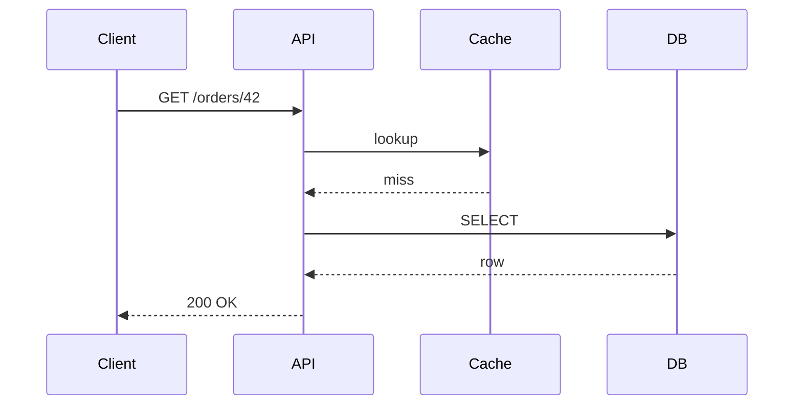

This post is a reference for writing posts on this site. Copy it, delete what
you don't need, and keep the frontmatter shape.

## Frontmatter

Every post starts with a YAML block. `title`, `description` and `date` are
required. `updated`, `tags`, `draft`, `cover`, `cover_alt` and `canonical_url`
are optional. Leave `canonical_url` empty unless the post first appeared
somewhere else.

## Code blocks

Code blocks are highlighted at build time and get a copy button.

### Go

```go
package main

import (
	"context"
	"log/slog"
	"time"
)

func main() {
	ctx, cancel := context.WithTimeout(context.Background(), 2*time.Second)
	defer cancel()

	<-ctx.Done()
	slog.Info("shutting down", "reason", ctx.Err())
}
```

### YAML

```yaml
apiVersion: apps/v1
kind: Deployment
metadata:
  name: api
spec:
  replicas: 3
  selector:
    matchLabels:
      app: api
```

### HCL

```hcl
resource "aws_s3_bucket" "artifacts" {
  bucket = "example-artifacts"

  tags = {
    Environment = "prod"
  }
}
```

### Bash

```bash
#!/usr/bin/env bash
set -euo pipefail

for svc in api worker; do
  echo "deploying ${svc}"
done
```

### Dockerfile

```dockerfile
FROM golang:1.25 AS build
WORKDIR /src
COPY . .
RUN CGO_ENABLED=0 go build -o /out/api ./cmd/api

FROM gcr.io/distroless/static
COPY --from=build /out/api /api
ENTRYPOINT ["/api"]
```

## Diagrams

Fenced `mermaid` blocks are rendered to SVG when the site builds:



## Tables and callouts

| Check      | Runs on      |
| ---------- | ------------ |
| Build      | every PR     |
| Lighthouse | every PR     |
| Deploy     | push to main |

> [!NOTE]
> Callouts use the GitHub-style `> [!NOTE]` syntax.
