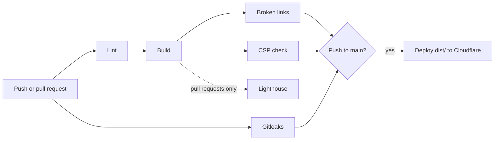

This site is a static site: plain HTML, CSS and a little JavaScript, built
once and served from a CDN. There is no server to patch and nothing to scale.
This post walks through the stack and the pipeline that decides whether a
change is allowed to ship.

## The stack

- **[Astro](https://astro.build/)** builds the site. Posts and projects are
  Markdown files in typed content collections, so a missing `title` or a
  malformed date fails the build instead of shipping a broken page.
- **[AstroPaper](https://github.com/satnaing/astro-paper)** is the theme. I
  kept its layout, gave it my own palette and a proportional body font (IBM
  Plex Sans, with mono for headings and code), and added projects, an About
  page and resume driven by YAML data, and a few blog features.
- **[Shiki](https://shiki.style/)** highlights code at build time, so readers
  download coloured HTML rather than a highlighting library.
- **[Mermaid](https://mermaid.js.org/)** diagrams are rendered to SVG during
  the build with `rehype-mermaid` and a headless Chromium. Readers never
  download Mermaid itself.
- **[Cloudflare Workers](https://developers.cloudflare.com/workers/static-assets/)**
  serves the files as static assets and applies the security headers from a
  `_headers` file. No Worker code runs; it is purely static hosting.

## The pipeline

Every push and pull request runs the same core checks. Lighthouse, the
slowest, runs on pull requests only, and a push to `main` deploys once the
core checks pass:



| Check        | Tool                         | Fails when                                   |
| ------------ | ---------------------------- | -------------------------------------------- |
| Formatting   | Prettier                     | a file isn't formatted                       |
| Lint         | ESLint, markdownlint         | code or Markdown breaks a rule               |
| Build        | `astro check && astro build` | a type error or invalid frontmatter          |
| Broken links | linkinator                   | a link, image or `#fragment` doesn't resolve |
| CSP          | Playwright                   | any page logs a CSP violation or JS error    |
| Performance  | Lighthouse CI (PRs only)     | any category scores below 95                 |
| Secrets      | Gitleaks                     | a credential appears anywhere in history     |

The deploy job only runs after the core checks pass, and it deploys the
exact `dist/` folder that was checked rather than rebuilding it. Lighthouse
stays off the deploy path: it's the slowest check, and scores don't drift
from one push to the next.

## A CSP that can't drift

The Content Security Policy is the piece I like most. Scripts are only
allowed from the site itself, plus a short list of inline scripts identified
by their SHA-256 hash:

```bash
script-src 'self' 'sha256-…' 'sha256-…' 'sha256-…'
```

Hand-maintained hashes go stale the moment someone edits an inline script.
So a small Astro integration runs after every build, hashes each inline
`<script>` it finds in the generated HTML, and writes `_headers` from those
hashes. The policy is derived from the output, so it can't fall out of sync.

The CSP check then loads every page in headless Chromium, with the real
headers applied, and fails on any violation. That check found a real bug on
its first run: Astro's client-side router injects an empty `data:` script
when a page has inline module scripts. The fix was to stop inlining bundled
scripts rather than loosening the policy.

## Supply chain hygiene

- Every GitHub Action is pinned to a full commit SHA, not a movable tag.
- Workflows default to `contents: read`; jobs ask for more only when needed.
- Dependabot opens weekly, grouped update PRs for npm packages and Actions,
  and those PRs go through the same checks.
- API keys for cross-posting live in environment variables, never in the
  repository, and Gitleaks blocks any that slip through.

## Writing and cross-posting

A new post is one Markdown file. Once it's live here, a small script creates
drafts on dev.to and Hashnode with the canonical URL pointing back to this
site, so search engines treat this page as the original:

```bash
npm run crosspost -- src/content/posts/how-this-site-is-built.md --dry-run
```

The source is a normal Astro project; the README covers running it locally.
