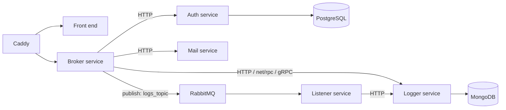

## Architecture

- **Broker**: the single entry point. It takes a JSON action (`auth`, `log`,
  `mail`) and forwards it to the right service, so clients only know one URL.
- **Auth**: users in PostgreSQL through `database/sql`, passwords checked
  with bcrypt. Data access sits behind a repository interface.
- **Logger**: stores entries in MongoDB and accepts them over HTTP, Go's
  `net/rpc`, and gRPC (contract in `logs.proto`).
- **Events**: the broker can publish log events to a RabbitMQ topic exchange
  instead; the listener service consumes them and calls the logger.
- **Deployment**: each service has its own Dockerfile and versioned image on
  Docker Hub. `proj/` holds a Compose file, a Swarm stack, and Kubernetes
  manifests per service plus an ingress, with Caddy as the reverse proxy.

## Key decisions

- **A broker instead of clients calling services directly.** Services can
  move, split or change protocol without the front end noticing.
- **Several transports for the same operation.** HTTP is simplest to debug,
  RPC and gRPC give typed contracts, and the queue decouples the caller
  from the logger entirely: the broker returns as soon as the event is
  published.
- **Repository interface in the auth service.** Handlers depend on an
  interface, so tests swap in a fake repository instead of a database.
