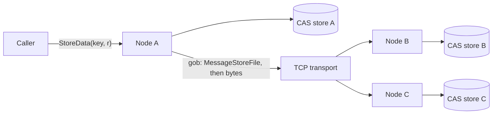

## Architecture



Every node runs the same binary and is both client and server. A node starts
by dialling its bootstrap peers, one goroutine per address, then serves
requests from the network.

- **Store**: a key is hashed with SHA-1 and the hex digest is split into
  10-character segments that become nested directories, so no single folder
  grows huge and the path is derived from the key alone.
- **Transport**: a `Transport` interface with a TCP implementation and a
  pluggable handshake, so the file server doesn't depend on TCP directly.
- **Messages**: control messages (`MessageStoreFile`, `MessageGetFile`) are
  gob-encoded. A marker byte tells the receiver that raw file bytes follow,
  and it reads exactly the announced size with `io.LimitReader`.

## Key decisions

- **Content addressing over user-chosen paths.** Where a file lives is a pure
  function of its key, so any node can find its copy without a lookup table.
- **Announce, then stream.** Sending the size in a small control message
  before the raw bytes keeps the protocol simple, and lets the receiver stop
  at exactly the right byte instead of waiting for the connection to close.
- **Transport behind an interface.** Swapping TCP for another transport, or a
  fake one in tests, doesn't touch the file server.

## Benchmark

`replication_bench_test.go` starts a hub and N peers on localhost, stores a
random file on the hub, and measures the time until every peer has the
complete file on disk:

```bash
go test -run TestReplicationBenchmark -v
```

Time until all peers have the file (two runs, AMD Ryzen 5 5600H, storage on
tmpfs, so this measures gstore's protocol and copy path rather than network
or disk):

| File   | 1 peer     | 2 peers    | 4 peers    |
| ------ | ---------- | ---------- | ---------- |
| 1 MB   | 6 ms       | 5 ms       | 5 ms       |
| 10 MB  | 20 ms      | 21–31 ms   | 32–34 ms   |
| 100 MB | 135–140 ms | 183–188 ms | 292–309 ms |

At 100 MB that is about 720 MB/s to one peer and about 1.3 GB/s aggregate to
four. Time grows with the peer count because the hub streams to peers one
after another.

**The bug it caught.** The first run showed only one peer ever finishing.
`StoreData` streamed every peer from the same `bytes.Buffer`, and reading a
buffer drains it, so peers after the first received zero bytes and waited
forever. Each peer now gets its own `bytes.NewReader` over the same bytes,
and copy errors are returned instead of swallowed.
