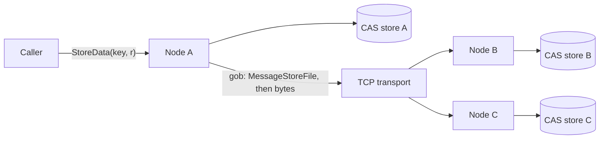

## Architecture

Every node runs the same binary and is both client and server. A node starts
by dialling its bootstrap peers, one goroutine per address, then serves
requests from the network.

- **Store**: a key is hashed with SHA-1 and the hex digest is split into
  10-character segments that become nested directories, so no single folder
  grows huge and the path is derived from the key alone.
- **Transport**: a `Transport` interface with a TCP implementation and a
  pluggable handshake, so the file server doesn't depend on TCP directly.
- **Messages**: control messages (`MessageStoreFile`, `MessageGetFile`) are
  gob-encoded. A marker byte tells the receiver that raw file bytes follow,
  and it reads exactly the announced size with `io.LimitReader`.

## Key decisions

- **Content addressing over user-chosen paths.** Where a file lives is a pure
  function of its key, so any node can find its copy without a lookup table.
- **Announce, then stream.** Sending the size in a small control message
  before the raw bytes keeps the protocol simple, and lets the receiver stop
  at exactly the right byte instead of waiting for the connection to close.
- **Transport behind an interface.** Swapping TCP for another transport, or a
  fake one in tests, doesn't touch the file server.

## What's next

- Wire the existing AES-CTR helpers into transfers, so files are encrypted
  before they leave a node.
- Split large files into chunks, so replication can resume and run in
  parallel.
- Replace bootstrap-only discovery with a DHT.
