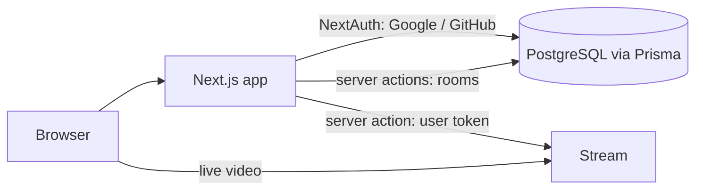

## Architecture

- **Auth**: NextAuth with Google and GitHub providers and the Prisma adapter,
  so users, linked OAuth accounts and sessions live in PostgreSQL.
- **Rooms**: a `Room` belongs to a user and has a name, description,
  language and optional GitHub repo. Creating and deleting rooms are Next.js
  server actions.
- **Video**: the Stream Video React SDK runs in the browser. Its user token
  is created in a server action with the Stream secret, which never reaches
  the client.

## Key decisions

- **Server actions instead of a separate API.** Room changes and token
  issuing live next to the UI that uses them, with no extra service to run.
- **A managed video provider.** Building WebRTC signalling and TURN
  infrastructure would have dwarfed the rest of the app.
- **Cascade deletes in the schema.** Deleting an account removes its
  sessions, OAuth links and rooms in the database, not in application code.
