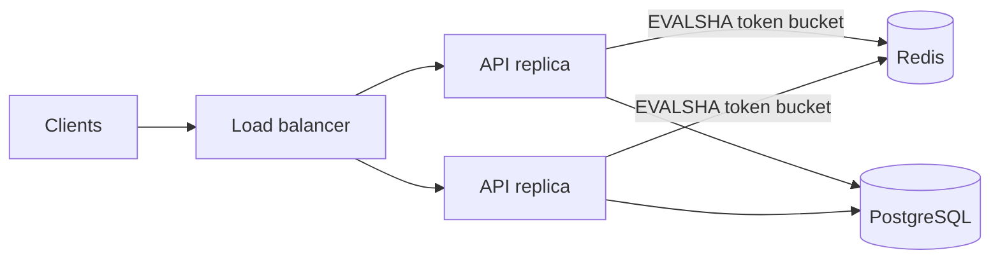

## Architecture

Each replica runs one Lua script in Redis per request, so refilling and
taking a token is a single atomic step.

## Key decisions

- **Token bucket in a Lua script, not `INCR` + `EXPIRE`.** One round trip, and
  no race between reading and refilling the bucket.
- **Fail open when Redis is unavailable.** A short Redis outage should not take
  the API down; a local fallback limiter caps the damage.
- **Per-client keys with a TTL.** Idle clients cost nothing, and memory stays
  bounded without a cleanup job.
