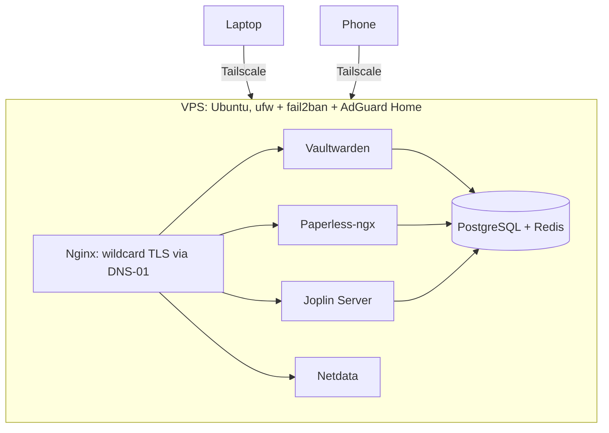

## Architecture

- **Network**: devices reach the VPS only over Tailscale, a WireGuard mesh.
  The firewall exposes nothing publicly, so the public attack surface is
  zero ports.
- **TLS**: Nginx terminates TLS with a wildcard certificate. HTTP-01
  challenges can't work when nothing is reachable from the internet, so
  certificates are issued with DNS-01 challenges instead.
- **Services**: Vaultwarden (passwords), Paperless-ngx (documents), Joplin
  Server (notes) and Netdata (telemetry), sharing PostgreSQL and Redis.
- **Hardening**: ufw and fail2ban, with AdGuard Home for DNS filtering.

## Key decisions

- **A private mesh instead of public endpoints.** No login page is ever
  exposed, so there is nothing to brute-force or scan.
- **DNS-01 over HTTP-01.** The certificate authority never needs to reach the
  server, which is what makes "zero public ports" compatible with real TLS.

## Lessons

**Two firewalls, one set of iptables chains.** After a firewall reload, the
containers lost network access. Two firewall layers were rewriting the same
iptables chains, with the WireGuard mesh caught in between. Each was
individually correct and together they were fatal. The fix was to stop
fighting the platform: ufw and fail2ban only, let Docker own its chains, and
run the affected container on host networking.
